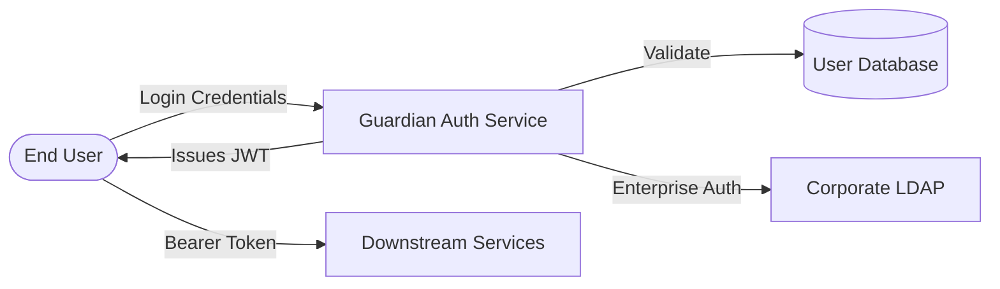
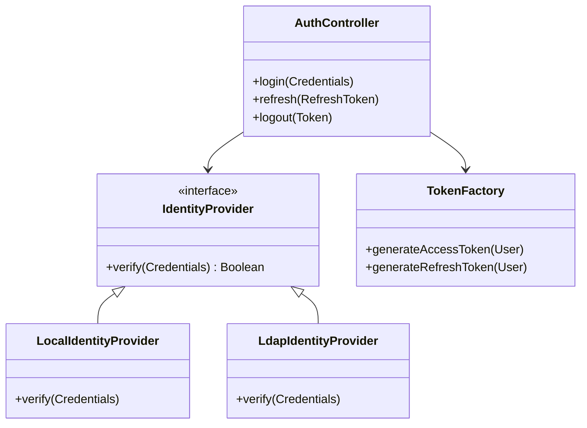

# Software Design Description
## For Guardian Auth Service

Version 1.0  
Prepared by Claude Architect  
Security Engineering Team  
2023-10-27

## Table of Contents
* [1. Introduction](#1-introduction)
* [2. Design Overview](#2-design-overview)
* [3. Design Views](#3-design-views)
* [4. Decisions](#4-decisions)
* [5. Appendixes](#5-appendixes)

## Revision History

| Name | Date | Reason For Changes | Version |
|------|------|--------------------|---------|
| Claude | 2023-10-27 | Initial Design for Auth Service | 1.0 |

## 1. Introduction
This document describes the architectural design of the Guardian Auth Service, a centralized microservice responsible for authentication and authorization across the enterprise ecosystem.

### 1.1 Document Purpose
The purpose of this SDD is to provide a detailed technical blueprint for the implementation of the Guardian Auth Service. It serves as a reference for developers during construction, for security auditors during review, and for operations teams managing the deployment.

### 1.2 Subject Scope
The Guardian Auth Service (v1.0) provides identity verification, password management, and JWT-based token issuance. 
**Included:** Login/Logout, Token Refresh, Password Hashing, Role-based Access Control (RBAC) claims.
**Excluded:** User profile management (handled by Profile Service), MFA hardware integration (handled by External Provider).

### 1.3 Definitions, Acronyms, and Abbreviations

| Term | Definition |
|------|------------|
| OIDC | OpenID Connect - An identity layer on top of the OAuth 2.0 protocol. |
| JWT  | JSON Web Token - A compact, URL-safe means of representing claims to be transferred between two parties. |
| RBAC | Role-Based Access Control - An approach to restricting system access to authorized users based on roles. |
| JWS  | JSON Web Signature - A standard for signing content using JSON data structures. |

### 1.4 References
- [REF-001] RFC 7519: JSON Web Token (JWT)
- [REF-002] OpenID Connect Core 1.0 specification
- [REF-003] Corporate Security Standards v2.4

### 1.5 Document Overview
Section 2 provides the architectural strategy. Section 3 contains specific views (Context and Logical). Section 4 documents key technical decisions (ADRs).

## 2. Design Overview

### 2.1 Stakeholder Concerns
- **Security Officers:** Concerned with credential leakages and cryptographic strength of tokens.
- **Frontend Developers:** Concerned with ease of integration and token refresh mechanisms.
- **SRE/Ops:** Concerned with service availability during high-traffic login events.

### 2.2 Selected Viewpoints
- **Context:** Defines the service boundaries and external integrations.
- **Logical:** Details the internal class structure and implementation abstractions.
- **Interface:** Specifies the REST API contracts.

## 3. Design Views

### VIEW-001: System Context
- **Title:** Guardian Auth Context
- **Viewpoint:** Context
- **Representation:**

- **More Information:** Implements requirements SRS-AUTH-01 (User Login) and SRS-AUTH-05 (External LDAP Support).

### VIEW-002: Logical Class Structure
- **Title:** Core Authentication Logic
- **Viewpoint:** Logical
- **Representation:**

- **More Information:** This structure supports the Strategy Pattern for multiple identity backends as decided in DEC-001.

## 4. Decisions

### DEC-001: Use of OIDC over Custom Session Management
- **ID:** DEC-001
- **Title:** Adoption of OpenID Connect (OIDC) Standard
- **Context:** The system needs to support multiple frontend clients (Web, Mobile) and third-party integrations. Custom server-side sessions would require shared state or sticky sessions.
- **Options:** 
    1. Custom Server-side Sessions (Redis-backed)
    2. JWT-based Stateless Auth
    3. OpenID Connect (OIDC) implementation
- **Outcome:** **OpenID Connect**, because it provides a standardized way to handle identity, reduces integration friction with third-party tools, and allows for stateless scaling of the Auth Service.
- **More Information:** Aligns with [REF-002]. Influences VIEW-001 and VIEW-002 regarding token generation.

## 5. Appendixes
- **Data Dictionary:** See `docs/data/identity-schema.sql`
- **Traceability Matrix:** Links SRS requirements to the views defined in Section 3.
