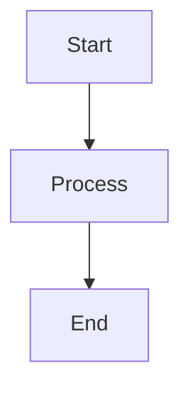

### View ID: [VIEW-000] - {View Title}

**Date Modified:** {YYYY-MM-DD}
**Status:** {Draft | Proposed | Accepted | Deprecated}

---

#### 1. Viewpoint
<!-- Select one: Context, Composition, Logical, Physical, Structure, Dependency, Information, Interface, Interaction, Algorithm, State Dynamics, Concurrency, Patterns, Deployment, Resources -->
**Type:** {Viewpoint Name}

#### 2. Representation
<!-- Provide a natural language description of this design element followed by a Mermaid diagram -->

{Describe the purpose, responsibilities, and key characteristics of this design element.}

#### 3. More Information
- **Requirement Traceability:** {List SRS IDs implemented by this view, e.g., SRS-001, SRS-012}
- **Related Decisions:** {List Decision IDs that influenced this view, e.g., DEC-001, DEC-005}
- **Dependencies:** {List other View IDs that this view depends on}
- **Constraints/Risks:** {Note any specific technical constraints or known risks associated with this design}
