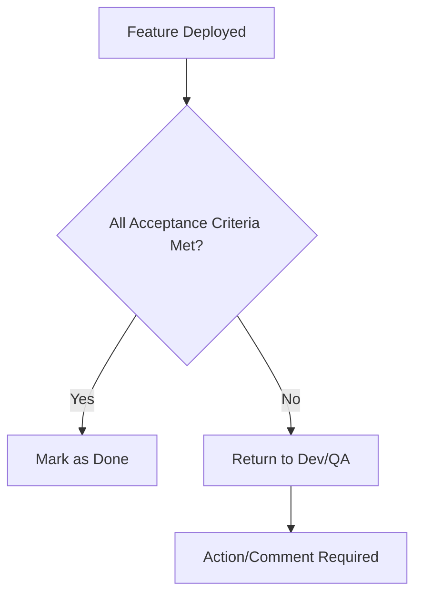
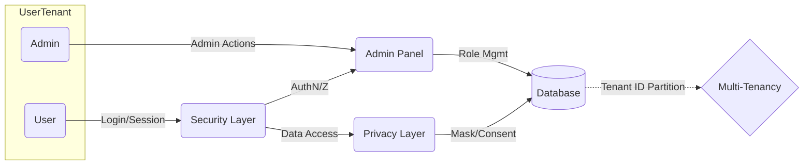
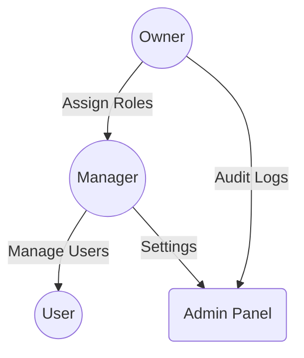

**Date:** 2026-01-31
**Scope:** End-to-end for launch (V1) with detailed owner-configurable settings, privacy controls, and core features.

---

## 0. Table of Contents

1. [Overview & Objectives](#1)
2. [Target Users & Roles](#2)
3. [Multi-Tenant Fundamentals](#3)
4. [Product Feature Domains](#4)
   - General Business Settings & Onboarding
   - Inventory Intake & Adjustments
   - POS and Transactionality
   - Product Aliases/Nicknames
   - Privacy & Data Lockdown (with Failsafes)
5. [Non-Functional & Compliance Requirements](#5)
6. [Acceptance Criteria](#6)
7. [Owner/Manager Settings Matrix](#7)
8. [Open Questions/Pending Design](#8)
9. [V1 Roadmap, Post-V1 Roadmap & Addendums](#9)

---

<a name="1"></a>

## 1. Overview & Objectives

**Vision:**
DeelRx is a unified, multi-tenant platform providing regulated, inventory-driven retail with:

- Blazing-fast, accurate, privacy-first POS (Mobile + Web)
- Granular, owner-configurable privacy and security
- Full business control: inventory, credit, adjustments, audit, aliases, and compliance
- A spectrum from “open CRM” to “max secure alias-only” operation, with built-in failsafes

---

<a name="2"></a>

## 2. Target Users & Roles

| **User Level**     | **Devices**  | **Core Needs**                                     |
| ------------------ | ------------ | -------------------------------------------------- |
| Owner/Admin        | Web + Mobile | Config, compliance, risk, full control             |
| Manager/Supervisor | Web + Mobile | Inventory, reporting, advanced workflows           |
| Cashier/Employee   | Mobile       | Fast sales, minimal friction, compliance adherence |

---

<a name="3"></a>

## 3. Multi-Tenant Fundamentals

- **Tenant Isolation:** Each business is a silo; no cross-tenant access to data or presentation.
- **User Scoping:** Users may have accounts on multiple tenants/brands but never cross-pollination of team/content.
- **Tenant Onboarding:** All business-critical settings are captured & enforced at onboarding (see below).

---

## 4. Product Feature Domains

### 4.1 General Business Settings & Onboarding

#### **Feature Summary**

Capture all essential business data and owner preferences with a highly guided onboarding flow.
**All required fields must be unambiguous. Defaults shown at each step. All fields are always tenant-specific.**

#### **Detailed Requirements**

**Required on Onboarding:**

- Business Name (required)
- Shop Phone Number (required)
- Supported Units (select: grams, ounces, pounds, liters, milliliters—multiple can be enabled; default: all)
- Owner Contact (must provide secondary recovery email)
- Privacy Preset Selection (Open, Balanced, Private, Max Secure) | See [Privacy](#privacy) section
- Quickpick Product Quantities (edit: e.g., 1g, 3.5g, 7g, 1oz, 1L, etc.)
- Initial User Roles (Owner, Manager, Staff; can add custom roles)
- Product Alias Table (optional at onboarding, required before inventory import)
- [Optional] Store Address, Business Hours, Legal License/ID

**Editable at Any Time:**
All the above fields, plus:

- Intake/Adjustment Reasons (editable lists, required for audit log compliance)
- Credit Limit Policy (max per customer, required/optional manager overrides)
- Loyalty Program (enable/disable, tiers and percentages)
- POS Settings (enable/disable barcode, haptic feedback, offline mode)
- Compliance Retention Rules (GDPR mode, audit log retention)
- Allowed Export Types (limit data export by role/preset)
- Advanced triggers (see Privacy section)

**Onboarding Acceptance Criteria:**

- System will not allow transactional use until all required fields set.
- All onboarding settings are shown with “default values,” explanations and suggested best practice text.

---

### 4.2 Inventory Intake & Basic Adjustments

#### **Feature Summary**

All inventory actions are secure, auditable, and context-aware—supporting quick additions, adjustments, batch workflows, and full multi-unit conversion.
**Owner/manager configures which units are allowed, alias/nicknames, reasons for change, and staff permissions.**

#### **Detailed Requirements**

- **Supported Units:**
  - Business can enable any combination of: grams, ounces, pounds, liters, milliliters.
  - The system always handles conversion (e.g., 28g = 1oz, 1000ml = 1L), inventory can be entered in any enabled unit, displayed in canonical or business-preferred units.
  - All calculations are base-united and converted for consistency.
- **Intake (Mobile & Web):**
  - Product selection (by text search or barcode scan if enabled)
  - Quantity entry (auto-fills if standard alias is used)
  - Entry can be by mass or liquid volume depending on item
  - Reason selection (from owner-managed list, e.g.: “Restock”, “Sample Return”, “Correction”)
  - Optional: cost per unit (toggle enable/disable on mobile)
  - Confirmation summary shown before processing
- **Adjustments:**
  - Allow increments (e.g., +7g), decrements (-2oz), or absolute-set (“set to 100ml”)
  - All require reason (customizable list, e.g.: “Theft”, “Damage”, “Recount”)
  - Permission to adjust, and max allowed per staff/day, are owner-configurable
- **Batch Intake/Bulk (Web only):**
  - CSV import or multi-row entry (“Add 50 products at once”)
  - All required fields, no silent/skipped entries
  - Supplier/invoice, optional document/image upload (controlled by owner in settings)
  - Bulk-audit: all row changes are single transaction for audit, per-operator
- **Audit Logging:**
  - Every action stores: user, timestamp, previous qty, new qty, change delta, reason, device/app source
  - Logs are per tenant; cannot be exported or viewed except by authorized role per privacy preset
- **Performance:**
  - Mobile single intake <10s; bulk web <2s per 50 items
- **Error Handling:**
  - Staff see real-time feedback, haptic response
  - Block duplicate or conflicting entries; provide conflict messaging

#### **UI/Workflow Notes**

- “Add Inventory” easily accessible from POS/home
- Selectable quickpick for most-used units/aliases
- Recent changes/audit log view quick-access (last 5 events) for staff

#### **Non-Functional**

- Strict per-tenant separation, no cross-business inventory
- All forms auto-convert and display both input and canonical units before finalizing

#### **Acceptance Criteria**

- All changes reflect in audit logs within 30s
- Only users with correct permissions can intake/adjust; all attempts are logged

---

---

## 5. Non-Functional & Compliance Requirements

### 5.1 Non-Functional Requirements (NFR) Checklist

- **Performance**
  - [ ] System response time < 2s under typical load
  - [ ] Supports 5,000 concurrent users
- **Scalability**
  - [ ] Auto-scale compute and storage
  - [ ] Modular services for horizontal expansion
- **Availability**
  - [ ] 99.9% uptime commitment
  - [ ] Deploy on redundant infrastructure
- **Reliability**
  - [ ] Automatic failover and disaster recovery
  - [ ] Data replication and daily backups
- **Security**
  - [ ] All data encrypted in transit (TLS 1.2+)
  - [ ] OWASP Top 10 risks mitigated
  - [ ] SSO/OAuth2 support
- **Privacy**
  - [ ] GDPR, HIPAA compliance controls
  - [ ] User data deletion on request
- **Compliance**
  - [ ] SOC 2 Type II readiness
  - [ ] PCI DSS self-assessment

### 5.2 Compliance Documentation Outline

| Requirement   | Description                                 | Owner          | Status      |
| :------------ | :------------------------------------------ | :------------- | :---------- |
| SOC 2 Type II | Controls, audit logs, policies              | CISO           | In Review   |
| GDPR          | DPO role, data subject rights, RTBF process | Legal          | Drafted     |
| HIPAA         | ePHI risk assessment, BAAs                  | Compliance Mgr | In Progress |
| PCI DSS       | Annual SAQ, quarterly scans                 | DevOps Lead    | Pending     |

---

## 6. Acceptance Criteria Assets

### 6.1 Acceptance Criteria Template

| Epic/User Story         | Acceptance Criteria                                              | Test Method      | Success Metric |
| :---------------------- | :--------------------------------------------------------------- | :--------------- | :------------- |
| User Login Security     | Users can log in via SSO. Failed login attempts are rate-limited | Manual, Auto     | Pass/Fail      |
| Data Deletion           | User can request, verify, and confirm data deletion              | Automated test   | Data deleted   |
| Multi-Tenancy Isolation | Tenants cannot access each other's data                          | Pen-test, Review | No leaks       |
| Admin Permissions       | Only owners/managers can assign/revoke roles                     | Manual review    | Access table   |

### 6.2 Acceptance Criteria Flow



### 6.3 QA Readiness Checklist

- [ ] Automated test coverage ≥ 85% critical path
- [ ] Security tests included in CI (SCA, DAST)
- [ ] All endpoints have Swagger docs
- [ ] Privacy control verified (e.g., RTBF)
- [ ] Multi-tenancy isolation checks
- [ ] Owner/Manager permission tested
- [ ] Regression suite passes

---

## 7. Technical Solution / Architecture & API Breakdown

### 7.1 Logical View

- **Auth Service**: SSO/OAuth2, MFA
- **Privacy Layer**: Data masking, audit trail, RTBF orchestration
- **Tenant Isolation**: Context-aware query filter; logical isolation

### 7.2 Data Flow Diagram



### 7.3 API Contract Samples

**`POST /api/v1/tenant/{tenantId}/user/{userId}/delete`**

- Description: User deleted, data removal initiated
- Security: Bearer Auth

**`GET /api/v1/audit-logs?tenantId={tid}`**

- Description: Returns action logs for owners/managers only

---

## 8. Owner/Manager Settings Implementation

### 8.1 User Stories

- **As an owner**, I can create tenant-level managers and configure access levels, so my team can self-administer securely.
- **As a manager**, I can add or remove regular users, and only assign roles within my scope.
- **As a system admin**, I monitor audit log changes, receive alerts for privileged operations, and update permission templates.

### 8.2 Admin Panel Flows & Permissions



### 8.3 Acceptance Tests (Gherkin)

```gherkin
Feature: Owner/Manager Permissions
  Scenario: Owner adds new manager
    Given I am logged in as owner
    When I invite "manager@acme.com" as Manager
    Then "manager@acme.com" should appear in user list with Manager role

  Scenario: Manager cannot assign Owner role
    Given I am logged in as Manager
    When I try to assign Owner role
    Then I should receive an "Access Denied" error
```

---

## 9. Appendix: Wireframes, Risks & Roadmap

### 9.1 Wireframe Samples

- **Admin Panel**: Tenant/User management, Role assignment UI
- **Audit Logs Page**: Filter, download logs
- **Settings**: Toggle Compliance features, Webhooks

### 9.2 Risk Matrix

| Risk                     | Likelihood | Impact | Mitigation                 | Owner      |
| :----------------------- | :--------- | :----- | :------------------------- | :--------- |
| Data Leak                | Medium     | High   | PenTest, encrypted TB, DLP | SecEng     |
| Downtime during Deploy   | Low        | Med    | Blue-Green deploy          | DevOps     |
| Non-compliance Penalties | Low        | High   | Legal review, audits       | Compliance |

### 9.3 Project Roadmap

```mermaid
gantt
    title Project Roadmap: Key Milestones
    dateFormat  YYYY-MM-DD
    section Core Features
    Security Alpha          :a1, 2024-06-01, 7d
    Privacy Alpha           :a2, after a1, 5d
    Multi-Tenancy Beta      :a3, after a2, 10d
    section Compliance
    SOC 2 Controls          :b1, after a3, 5d
    HIPAA Policy Complete   :b2, after b1, 4d
    section General
    QA Automation Coverage  :c1, starts after a1, 10d
    Final UAT/Sign-off      :d1, after b2, 3d
```

---

**END OF PRD V1 (Including Part 3 Assets)**

(Reply to request any of the appendix/sample visual materials, onboarding guides, or further breakouts for feature-specific design sprints.)
