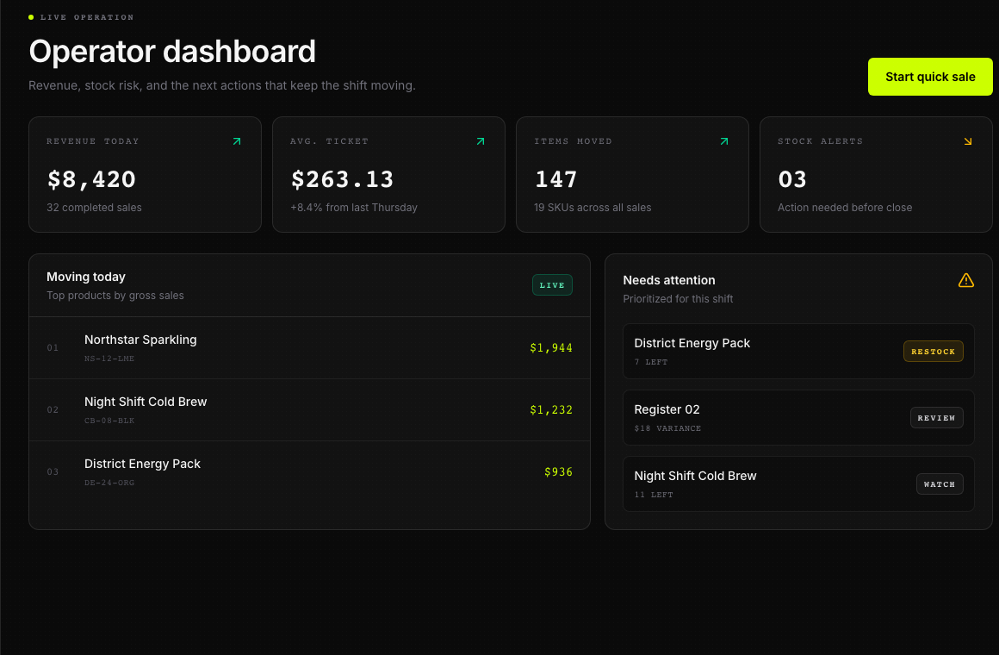

## Before you start

These steps cover the desktop web beta. You need access to the business and its reports. An empty chart does not prove there were no sales.

Illustrative screen with fictional data.

## Check your numbers

1. Confirm the active business, then open **Home** for its summary.
2. Open **Sales** to check the saved sales behind a total. The recent list shows up to 50 orders.
3. Open **Reports** and read **Window:** before comparing figures. Check the displayed dates rather than assuming every card covers the same period.
4. Compare **Today Sales**, **Today COGS**, **Week Gross Profit**, and **Outstanding Credit** only with records for the matching period and business.
5. Review **Recent Sales Margin** and **Top Products This Week** where shown. Missing costs can affect a margin calculation.

**Trends** is a separate web page. Its summary is not a substitute for checking saved sales. Do not change a sale or balance merely to make a chart match.

## Export reconciliation data

1. In **Reports**, confirm the business and **Window:**.
2. Choose **Export reconciliation CSV** if your account can use it. This download requires you to stay signed in.
3. Open the file and check its period and totals against the report before sharing it through your business's approved private process.

A CSV creates a separate copy of data. Keep it in approved storage; later changes or deletion in DRX do not delete downloaded copies. This export is not a full account backup.

## What happens next

Use the saved order and payment records to investigate differences. A credit sale and a payment toward an existing balance are different events.

If you have separately approved access to an iPhone test build, its Reports page labels the daily view **Daily totals (UTC)**. UTC can differ from your local day. This guide does not announce iPhone distribution or report parity on every device.

## Related articles

- [Sales history and receipts](https://drx.featurebase.app/en/help/articles/5281725)
- [Troubleshoot dashboard and reports](https://drx.featurebase.app/en/help/articles/3489602)
