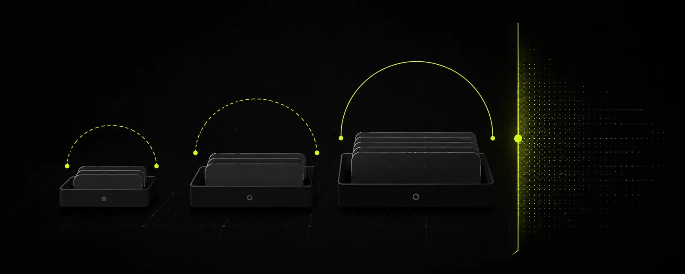
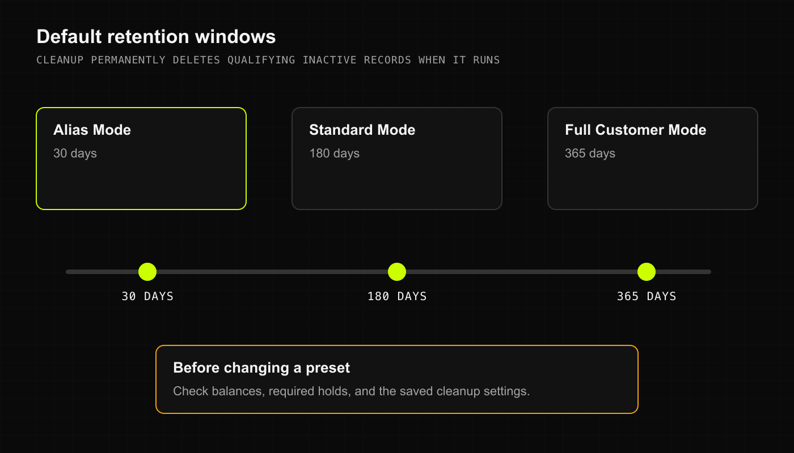
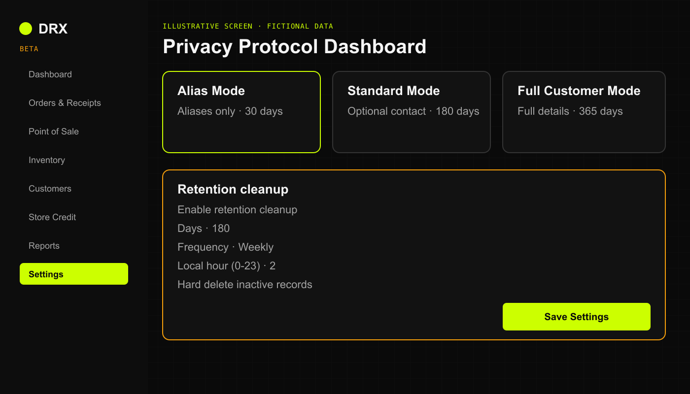

## Before you start

You need permission to change the business's privacy settings. Check outstanding balances, retention needs, and any required hold before changing a preset or running deletion. Do not use real customer records to test deletion.

Privacy settings apply to the selected business. Screen masking, retention cleanup, and account access are separate controls.

## Choose a privacy preset

The current presets are:

- **Alias Mode**: aliases only. The default retention period for inactive customer records is **30 days**.
- **Standard Mode**: aliases with optional contact information. The default retention period is **180 days**.
- **Full Customer Mode**: full customer details. The default retention period is **365 days**.

Use the least information your business needs. An alias can still identify someone; it is not a guarantee of anonymity. Optional fields do not have to be filled in.

Illustrative screen with fictional data.

## Review and save the settings

1. Confirm the active business and open **Settings**.
2. Under **Privacy Protocol Dashboard**, review **Onboarding Profile** and its description. Changing the preset resets its default privacy options, so recheck them before saving.
3. Check **Enable retention cleanup**, **Days**, **Frequency**, **Local hour (0-23)**, and **Hard delete inactive records**.
4. Read the deletion consequence below. A custom **Days** value changes the saved window from the preset default.
5. Choose **Save Settings** only when the result matches your business's approved policy. Reopen Settings and confirm the saved values.

## What happens when cleanup runs

Retention cleanup **permanently deletes qualifying inactive customer records when it runs**. It does not just hide them. A shorter retention period can make older inactive records qualify at the next run.

The current cleanup checks the last recorded activity and the saved retention settings. It skips records with an outstanding positive credit balance or an active legal hold. Temporary customer records use a separate retention path. Do not assume this setting deletes every sale, financial record, audit entry, backup, or exported copy.

The configured schedule is not proof that a cleanup ran successfully. If you need to confirm a deletion or understand what will qualify, ask private support before changing the setting. This guide does not promise recovery of permanently deleted records.

## Check screen privacy and exports

**ProteXion Mode (Screen Privacy)** changes what is shown on screen. It does not itself permanently delete stored records or revoke account access.

Check the actual Settings values rather than device or privacy badges on the workspace overview; those badges are not a reliable privacy status report in the beta.

Keep downloaded reports in approved storage. Deleting records in DRX does not delete files you already exported. For an account-wide export or permanent deletion request, contact private support for a scope review; there is no full account deletion procedure promised here.

## Related articles

- [Help and support](https://drx.featurebase.app/en/help/articles/2070517)
