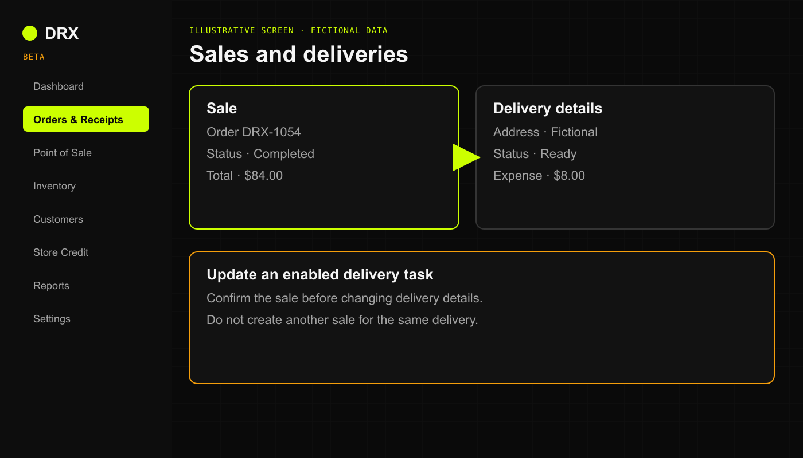

## Before you start

The old Standard Sales console instructions no longer match the web beta. Use **Point of Sale** to create a sale, **Orders & Receipts** to inspect it, and **Deliveries** for enabled delivery work.

Confirm delivery access, the actual vendor quote, and who will pay the fee. DRX records delivery work; it does not automatically book an Uber or other vendor order.

Illustrative screen with fictional data.

## Include delivery in a sale

1. Build the sale in **Point of Sale**, then continue to payment.
2. In **Delivery**, turn on **Include delivery**.
3. Enter **Delivery address** and the actual **Uber/vendor quote**. Do not put delivery details in public feedback or unrelated notes.
4. Under **Who pays the vendor fee?**, choose **Charge customer** or **Business absorbs** according to the approved arrangement.
5. Wait for the total to update. Review any **Delivery charged**, **Delivery tax**, or **Delivery absorbed** amount.
6. Complete the sale once, then confirm its saved order and delivery task.

For the complete payment procedure, use [Quick Sale checkout](https://drx.featurebase.app/en/help/articles/0236106).

## Update an enabled delivery task

1. Open **Deliveries** and select the task for the saved order.
2. Use **Assign to me** or an authorized assignment action as needed. Reveal the address only when required for the delivery; **Reveal address (audited)** records that access.
3. Place the vendor order through the shop's approved external process.
4. Enter **Uber wait time / ETA (minutes)** and use **Mark ordered** only after the vendor order exists.
5. Use **Mark handed off** and **Mark delivered** when those events actually happen.

## What happens next

Check the task's saved status. A delivery cancellation does not cancel the sale or refund money. **Manager cancellation** and **Record adjustment** need authorized review; a financial adjustment in DRX is a record, not proof that a refund or transfer occurred.

Delivery is beta. If the controls are unavailable or a save is uncertain, stop and have the owner review the task before creating another sale or vendor order.

## Related articles

- [Troubleshoot checkout and payments](https://drx.featurebase.app/en/help/articles/3230948)
