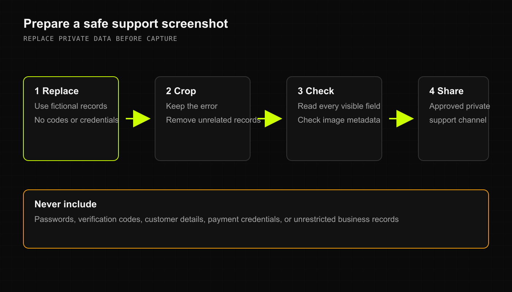

When something goes sideways in the middle of a rush, you need answers fast—not a robotic support bot asking you to turn your Wi-Fi router off and on again. The DRX human support team is here to help you get your registers humming and your shelves back in order.

Here is how to reach us, how to share what is happening without leaking customer privacy, and how to access DRX across your devices.

## How to get help without exposing customer privacy

Whenever you hit a snag—whether an inventory intake won't calculate properly or a card terminal feels sluggish—send an email directly to **[support@deelrxcrm.com](mailto:support@deelrxcrm.com)**.

To help us fix your issue in record time without playing twenty questions, include:
1. **The hardware & platform**: Are you on the Desktop Web app on Chrome, the native iOS app on an iPad register, or Android / Mobile Web on an inventory handheld?
2. **The screen and action**: Exactly where were you standing? (e.g., "Scanning a 10-pack of gummies into the cart at the checkout register").
3. **The unexpected result**: Did an error message pop up? Did the drawer refuse to open?
4. **Approximate time**: Knowing whether it happened five minutes ago or yesterday afternoon helps us pinpoint the exact transaction record.

### Safe screenshot rules

A screenshot is worth a thousand words, but it can also accidentally broadcast a customer's phone number or credit balance to the world if you aren't careful. Before attaching an image:
- **Crop tightly**: Capture only the error banner or the cart total, leaving out customer names and phone numbers.
- **Redact private details**: Scribble over or blur customer identifiers, addresses, and notes.
- **Never share passwords or payment details**: Our team will never ask for your account password, PIN, or full credit card numbers.

## Getting help across your platforms

<Tabs>
  <Tab title="Desktop Web">
    - Access your store console at your provided web address.
    - If you hit a display glitch, try a hard refresh (`Ctrl + Shift + R` or `Cmd + Shift + R`).
    - Use the in-app help link or email [support@deelrxcrm.com](mailto:support@deelrxcrm.com) directly.
  </Tab>
  <Tab title="Native iOS (SwiftUI)">
    - Open the **Business** tab (`WorkspacesView`) to verify your active store connection, device status, and network connectivity.
    - If a scanner or Bluetooth receipt printer unpairs, check your iOS Bluetooth settings before contacting support.
    - For TestFlight early-access invites and iPad register setup, reach out to your account administrator.
  </Tab>
  <Tab title="Android & Mobile Web">
    - Tap **More** in the bottom tab bar.
    - Check the **Offline Control Card** to confirm whether your device is actively communicating with the store cloud or caching sales locally.
    - Use the **Help** or **Feedback & Roadmap** options under the Account section to send feedback directly to our team.
  </Tab>
</Tabs>

## Platform availability & early access

DRX is continuously expanding across modern retail environments:
- **Desktop Web**: Full feature set available for all active operators.
- **Native iOS (iPad & iPhone)**: Native SwiftUI register and management app available through verified early-access distribution.
- **Android & Mobile Web**: High-speed mobile register and floor management available via mobile browser and progressive web app.

To request access for additional store locations or join upcoming beta programs, visit the [early-access waitlist](https://deelrxcrm.com/waitlist) or reach out to your DRX account team.

