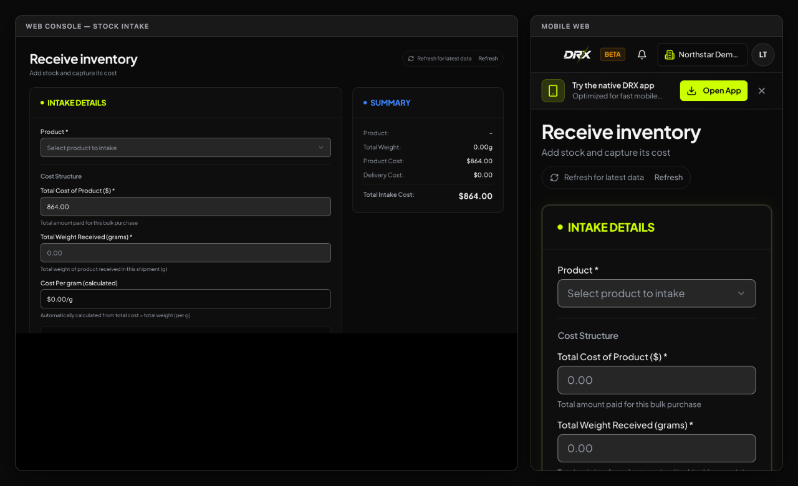

## Before you start

These steps cover the web beta. Confirm the business and your permission to manage Products. Know the product, unit, received quantity, and costs. Count the goods before recording them.

Illustrative screen with fictional data.

## Add or edit a product

1. Open **Products** and check for an existing product before choosing **Add product**.
2. Enter **Product Name**. Choose **Generate SKU** to let DRX assign a unique stock code, or **Enter my own** and type a SKU. A barcode is optional and separate from the SKU.
3. Choose the **Selling Unit** and whether to sell fractional amounts. DRX fills in matching quick quantities. If you enter custom minimums, steps, or quick amounts and they conflict, choose **Use recommended rules** or edit the amounts before saving.
4. Enter the **Selling price** for one full selling unit. Enter **Cost per selling unit** directly, or choose **I buy this in a different unit** and enter the package purchase price, quantity, and purchase unit. If the supplier's actual net weight differs from the package label, enter the actual amount in your selling unit. Review the calculated per-unit cost and margin. For example, $160 for 1 oz and a selling price of $35 per gram gives an estimated $5.64 cost per gram; the saved stock cost retains more precision than the preview.
5. Review the initial stock count and reorder alert, then choose **Add Product**, or **Create First Product** in the guided form, once. Confirm the saved product and values in Products.
4. Use **Edit product** for an approved product edit. Do not change a product's count to hide a missing sale or failed intake.

A product name, SKU, barcode, customer alias, and quantity shortcut are different things. A shortcut does not change the selling unit. The package cost helper applies when creating a product; later deliveries still use the actual cost and quantity entered at intake. This guide does not promise camera scanning, CSV import, or bulk intake on screens that do not offer them.

## Receive goods

1. In **Products**, choose **Add stock**.
2. Select **Product** and check the unit beside the received quantity or weight.
3. Enter **Total Cost** for the whole intake and the actual quantity received. Do not enter unit cost in the Total Cost field.
4. Enter **Supplier (Optional)** and **Delivery Cost** only when needed. Delivery cost is separate from the displayed product cost calculation.
5. Choose **Review & Process Intake**. Check the product, amount, unit, and costs.
6. Choose **Confirm Intake** once and wait for the result.

If the result says approval is required, have an authorized approver review it before treating the goods as available. Do not submit the same intake again.

## Correct a count

1. Verify the physical count and review recent sales and movements.
2. In **Products**, choose **Fix count**. On **Adjust inventory**, choose **Select Product**.
3. Choose **Set Quantity To** for a final count, **Add (+)** for an increase, or **Remove (-)** for a decrease.
4. Enter **Quantity** for that action and a specific **Reason**.
5. Review the change, then choose **Confirm Adjustment** once.

## What happens next

Return to Products and choose **Refresh**. Use **Stock history** to check the saved movement and resulting count. A pending approval or uncertain response needs review before another entry. A reorder threshold is a warning setting, not a correction to the actual count.

## Related articles

- [Troubleshoot stock and audit](../troubleshooting/troubleshoot-inventory-and-audit.md)
