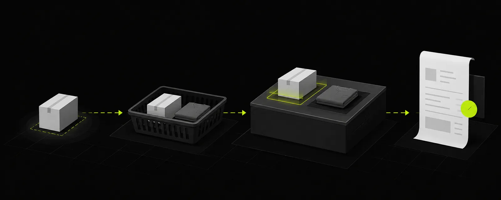
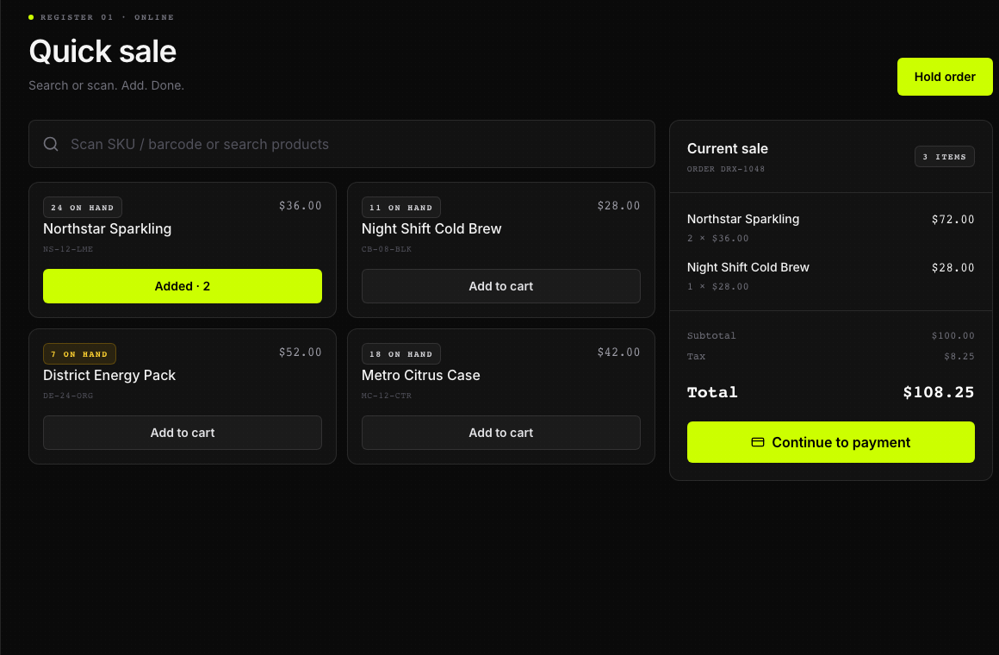

Checkout is the heartbeat of your store. When you have three people in line and someone is asking for "three and a half grams, plus a pre-roll, but wait can I put some on card and the rest in crumpled dollar bills?", you need a register that moves as fast as you do.

Here is how to ring up sales, calculate change down to the penny, and keep your inventory and cash drawer honest across all three platforms.

## Ringing up a sale across platforms

### On Desktop Web (Browser)
1. Click **New sale** in the left sidebar.
2. Add products to your cart:
   - Scan items with your USB or Bluetooth barcode scanner.
   - Or type in the **Scan SKU / barcode or search products** box.
   - Or click any item from your catalog grid.
3. Review line items: adjust quantities, fractional weights (grams or ounces), and confirm any bulk bundle pricing tiers.
4. **Attach a Customer (Optional)**: If the shopper has a store tab or loyalty profile, type their name, alias, or phone number in **Customer (Optional)** and click **Lookup**. If they're buying on store credit, an attached customer is required!
5. Click **Continue to Payment** (or the total button).
6. Pick your tender method:
   - **CASH**: Enter the amount tendered. DRX automatically calculates the exact change due so nobody has to do mental math during a rush.
   - **CARD**: Swipe or tap the card on your physical terminal first, then select **CARD** in DRX to lock the record in.
   - **CREDIT**: Charge the sale against the customer's verified store credit balance.
7. Choose your receipt preference (**PRINT**, **SMS**, or **NONE**) and click **Complete Sale**.

### On iPhone (Native iOS App)
1. Open the DRX app and tap the **POS** tab at the bottom of your screen.
2. Tap products from your category list or use the top search bar.
3. Need to weigh out a specific fractional amount? Tap the product to open the native weight dial and select exact grams or fraction increments.
4. Tap the green **Checkout** bar at the bottom to slide up the native checkout sheet.
5. Tap **Cash**, **Card**, or **Credit**. For cash, type what they handed you—your change due updates instantly in bold green digits!
6. Tap **Complete Sale** to finish with a satisfying haptic confirmation tap.

### On Android & Mobile Web
1. Open the **Register** tab from your bottom navigation bar.
2. Tap items to drop them into your sliding bottom cart.
3. Tap the cart handle to review items or apply an order discount.
4. Tap **Pay** to open the tender sheet. Use the quick cash tender buttons (**$20**, **$50**, **$100**) for lightning-fast cash transactions!
5. **Customer peering over your shoulder?** Turn on **Screen privacy** to hide customer account balances from in-store shoppers.
6. Hit **Complete Sale** to lock it in.

## Set a sale by dollar amount

For a fractional product, enter the amount the customer wants to spend. DRX suggests a quantity using the current unit, bulk, and loyalty pricing. Review the suggested quantity and edit it to match the amount you weigh or measure. Confirm the amount and quantity before adding the item or completing checkout.

If the confirmed quantity's normal price differs from the requested merchandise amount, DRX flags the variance and keeps the requested amount as the line price. This flag does not block checkout or require manager approval. Configured taxes and fees are added separately. The confirmed quantity determines the stock reduction and cost of goods.

On Android, dollar-amount sales require a live server quote. Reconnect before completing that sale; offline checkout cannot verify and record the requested amount and its variance.

## Common sense register rules

- **Customer Quick Create**: If the sale has no customer, use **Customer (Optional)** to look up or quick-create one without leaving checkout. Quick Create asks for a phone number and optional alias and follows the business's privacy settings.
- **Store Credit**: For credit sales, review customer eligibility and confirm the credit charge. Do not use credit to record repayment of an old balance.

- **Payment recording**: Selecting Cash, Card, or Credit in DRX records the transaction in your store's bookkeeping—it doesn't pull cash out of thin air or charge credit cards by itself. Always collect the actual cash or run their card on your terminal before finalizing!
- **Bundle pricing**: If you configured bulk pricing tiers (like an eighth for $35 or an ounce for $200), DRX automatically calculates the best volume price for the customer.
- **Uncertain connections**: If your internet blinks right as you hit complete, don't double-charge the customer! Open **Sales** to check if the order number already saved before ringing it up a second time.

## Related articles

- [Sales history and receipts](sales-history-and-receipts.md)
- [Troubleshoot checkout and payments](../troubleshooting/troubleshoot-checkout-and-payments.md)
