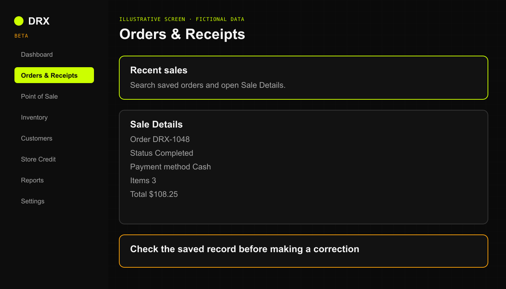

A customer walks back in thirty minutes after their purchase saying, "Hey, did you charge me for that extra lighter?" Or maybe your shift supervisor is auditing the register before drawer count. 

Whatever the reason, DRX keeps a permanent record of every completed order so you can pull up receipts, verify payment methods, and settle questions in seconds.

## Finding past orders across platforms

### On Desktop Web (Browser)
1. Click **Sales** in the left sidebar.
2. The **Recent Orders** table displays your last 50 transactions, complete with order number, timestamp, cashier, customer alias, tender type, and dollar total.
3. Use the search bar (**Search by ID or payment...**) to instantly filter by order ID (like `ORD-1042`), customer name, or payment method (`CASH`, `CARD`, `CREDIT`).
4. Click any order row to open **Sale Details**:
   - Inspect itemized lines, quantity sold, unit price, and discounts.
   - Review tax collected and total change given.
   - If an anonymous walk-in customer forgot to mention their store account, an authorized manager can use **Assign Customer** to link the order to their profile.

### On iPhone (Native iOS App)
1. Open the DRX app and tap **Sales** (or open history from the **POS** menu).
2. Scroll through your recent order cards. Orders are clearly labeled with green badges for Cash and purple badges for Card or Store Credit.
3. Tap any transaction card to expand its full receipt breakdown, including timestamp, cashier name, and line items.

### On Android & Mobile Web
1. Tap the **More** tab at the bottom of the register, then select **Sales history**.
2. Type an order reference or customer alias in the top search box.
3. Tap an order to view its itemized breakdown and payment receipt record.

## Voiding and refunding orders

When an order needs to be canceled or returned, authorized managers and operators with return permissions can void or refund the transaction directly from the order details.

### Understanding the difference between voids and refunds

- **Void Order**: Use when an order was rung up by mistake or cancelled immediately before fulfillment. Voiding cancels the order, reverses customer purchase counts, automatically cancels any linked active delivery, and restores all merchandise back into shelf inventory.
- **Refund Order**: Use when a customer returns items after a completed transaction. When issuing a refund, the operator selects the inventory disposition:
  - **Return to stock (restock)**: The merchandise is inspected, undamaged, and added back into your sellable inventory.
  - **Scrap / damaged (shrink loss)**: The merchandise was damaged, opened, or cannot be safely resold. It is recorded as damaged inventory shrink rather than returned to shelf stock.
  Any active delivery attached to the refunded order is automatically cancelled.

### Payment tender reversals

- **Cash, Comp, and Store Credit**: Cash refunds must be handed back from the drawer, and credit adjustments reverse the customer's store credit balance.
- **Card and Split Payments**: If an order was paid by card (or split tender including card), DRX requires recording the merchant card processor authorization code or external transaction reference to confirm the gateway reversal before finalizing.
- **P2P Payments (Cash App, PayPal, Zelle, Venmo, etc.)**: Confirm the peer-to-peer reversal in your payment app before finalizing the return record in DRX.

### How to void or refund on each surface

- **Desktop Web**: Open the order row from the **Sales** page. For completed sales, click **Void Order** or **Refund Order** in the action bar. Enter the mandatory reason, choose the inventory disposition (for refunds), confirm tender reversal, enter any card authorization reference, and click **Confirm**.
- **iPhone (iOS App)**: Open **Sales** or tap any recent sale on your Home dashboard or Reports view to open the **Sale Details** sheet. Tap **Void Order** or **Refund Order**, provide the reason and return parameters, and confirm.
- **Android & Mobile Web**: In **Sales history**, tap **Void** or **Refund** on any completed sale card to open the action sheet, select your disposition and reason, and confirm.

## Receipts, refunds, and record corrections

- **Add Customer After Sale**: On iOS, choose **Add customer to this sale** from the receipt after an anonymous sale. On Android, open **Sales history** and choose **Add customer** on the completed sale. Select the active customer and confirm. Linking a customer updates the customer's purchase history but does not change the saved total, payment, inventory, or credit entries. Credit sales cannot be reassigned.

- **Receipt Preferences**: When you choose **PRINT**, **SMS**, or **NONE** at checkout, DRX notes the shopper's preference. If a customer needs a reprint, you can review the exact line items and total on screen to verify their purchase.
- **Accidental Wrong Customer**: If a cashier accidentally rang up an order under "Dave" instead of "Dan", an authorized supervisor can reassign the customer profile in **Sale Details** so the right customer gets credit.
- **No Mystery Edits**: Editing a payment note in DRX updates your bookkeeping record; it does not transfer money or undo a card swipe. Keep your physical receipts and register slips matched with your digital records!

## Related articles

- [New sale checkout](quick-sale-checkout.md)
- [Troubleshoot checkout and payments](../troubleshooting/troubleshoot-checkout-and-payments.md)
