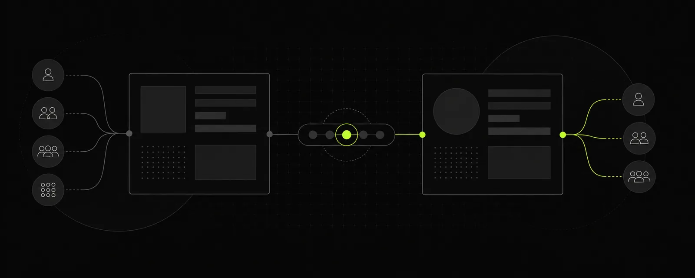
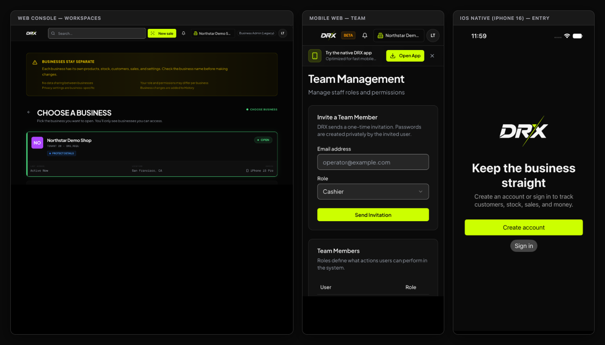

## Before you start

These steps cover the web beta. Finish or safely leave open checkout and unsaved work before switching businesses. Each business keeps its own records.

Illustrative screen with fictional data.

## Switch businesses

1. Open **Select a business** in the header. Check the entries under **My Businesses**.
2. Select the intended business from those attached to your account.
3. Wait for the page to load and confirm the business name before opening **Products**, **Customers**, or **Sales**.
4. Check the business again before saving a payment, correction, or export.

Switching businesses does not give you a different person's role. Do not use device, location, or privacy badges on the Business overview as a security report; some overview details are sample content in this beta.

## Invite a team member

1. With the required permission, open **Settings**, then **Manage Team**.
2. Under **Invite a Team Member**, enter **Email address**.
3. Choose the approved **Role** from the options your account offers. The team page includes Cashier, Supervisor, Manager, and Staff; privileged options need separate authorization.
4. Check the email and role, then choose **Send Invitation**. This sends an invitation to that person.
5. Check **Team Members** and confirm the membership after the person accepts. They create their own password; do not share the owner's login.

## Review or remove access

Review the member's role in **Team Members** before changing it. Permissions can differ by business and task. Business ownership does not grant DRX platform administration.

For offboarding, ask the owner and private support to confirm the supported removal and session-revocation process. Do not assume changing a role signs out every device immediately. This guide does not invent a deactivation button that the current team page does not provide.

## What happens next

Confirm the member can perform the approved task with their own account. Stop if they can see unexpected business records or sensitive details and report it privately.

## Related articles

- [Privacy and minimal data](feature-overview-privacy-controls.md)
- [Troubleshoot business access](../troubleshooting/troubleshoot-workspace-and-access.md)
