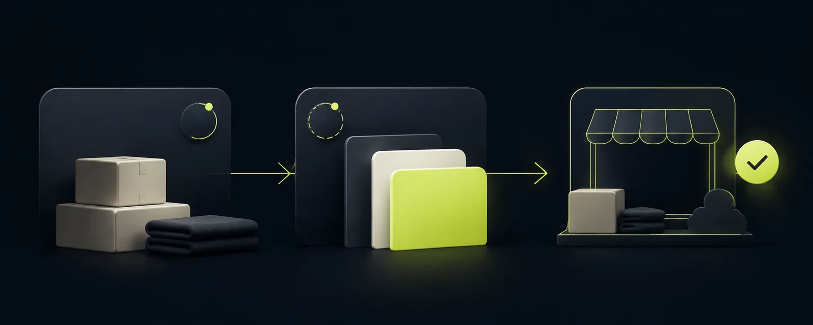

## Before you start

DRX is in early access. These steps cover the desktop web beta for accounts with access. Staff should use their business invitation, not create another owner account.

Have your business name, location, currency, time zone, and approved tax settings ready. Do not record practice sales in your real business records.

## Sign in or create an owner account

1. Open the DRX sign-in page supplied with your access invitation.
2. Sign in with your existing account. When a sign-in screen says **Username or email**, use either identifier already attached to that account.
3. If you are the owner and do not have an account, follow the owner registration link in your invitation. Complete the checks shown on screen.
4. If you have not received access, use the [early-access waitlist](https://deelrxcrm.com/waitlist). A registration page does not guarantee admission to the beta.

## Set up your business

1. At **Welcome to DRX**, choose **Set Up My Business**.
2. Enter **Full name** and **Business name**. Use **Continue** to move through setup.
3. Choose your business type. Check **Location name**, **City**, **State or region**, and **Country**.
4. Check **Currency** and **Time zone**. If you collect sales tax, choose **Yes** and enter your approved **Tax rate (%)**.
5. Choose whether to track stock. Choose **Invite someone now** only if you are ready to send an invitation; otherwise choose **I’ll do this later**.
6. At **Review your setup**, use **Edit** for corrections. Choose **Create My Workspace** once to create the Business, then wait for the result.

## What happens next

Open **Settings** and review your business details and privacy settings before adding customer information. Privacy choices can permanently delete qualifying inactive records when retention cleanup runs. Read [Privacy and minimal data](../feature_overview/feature-overview-privacy-controls.md) first.

Use **Products** to add products and check stock. Use **New sale** for checkout and **Sales** to check saved sales. On a narrow web screen, open **More** for customers, payments, reports, and settings available to your account. Desktop web keeps the main navigation beside your work. Phone apps may arrange these controls differently.

## If setup does not finish

Read the error and correct the field it names. Keep the setup page open while saving. Do not create a second account or business to work around an uncertain result. Ask private support to check it before trying again.

## Related articles

- [Add stock and fix a count](../feature_overview/inventory-intake-and-adjustments.md)
- [Switch businesses and check access](../feature_overview/switch-workspaces.md)
- [Help and support](../feature_overview/help-and-support.md)
