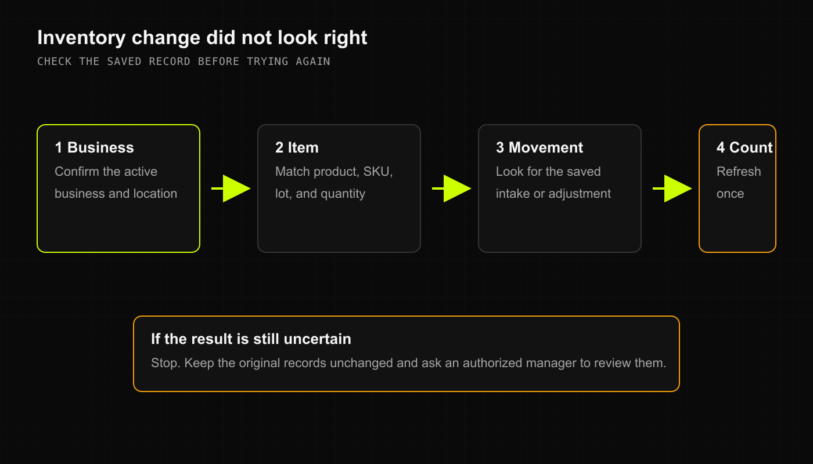

You just opened the stockroom to grab a top-selling SKU, but the register claims you're sold out—or conversely, you thought you had ten units on the shelf and the bin is completely empty.

Before you accuse anyone of running off with inventory, here is how to track down count discrepancies and fix your stock logs cleanly.

## 1. Why didn't my stock intake update the count?

If you entered a batch of incoming products and the on-hand count didn't increase:

1. **Check for Manager Approval**:
   - In some stores, inventory intake over a certain dollar amount or quantity requires manager sign-off before the stock goes live on registers.
   - If your intake is marked "Pending Approval", an authorized manager just needs to open the intake queue and approve it.
2. **Did the intake save with an error?**
   - DRX requires a valid, positive cost for inventory intake so your accounting and Cost of Goods Sold (COGS) numbers don't get thrown out of whack. If the cost field was left blank or zero, the intake won't process.
3. **Check the Stock History**:
   - In **Products**, click **Stock history**. Look at the most recent entries: if the intake saved, you'll see the exact timestamp, quantity added, and batch cost logged right there.

## 2. Solving count mysteries (Register vs. Shelf)

If your physical shelf count doesn't match the register screen:

1. **Pull the recent Sales History**:
   - Check if another cashier rang up the item on another register or mobile device five minutes ago.
2. **Review Recent Adjustments**:
   - In **Stock history**, check if a teammate logged shrinkage, breakage, or a spot recount earlier in the day.
3. **Make a Clean Adjustment**:
   - Don't try to "fix" a bad count by ringing up a fake \$0 sale or creating duplicate intake records.
   - Use **Fix count > Set Quantity To**, type your actual physical count, write a clear reason (e.g. *"Midday physical shelf audit"*), and save. DRX logs the delta automatically.

## 3. The product screen fails to refresh

If you made a count adjustment on your phone or laptop and the screen looks unchanged:
- Give the page a quick refresh. On iPhone, pull down on the list to refresh.
- Check your connection: if your device temporarily dropped Wi-Fi, the screen will update the moment it reconnects.
- Never spam the **Add (+)** or **Remove (-)** buttons repeatedly—otherwise you'll end up adding 10 units three times in a row!

## Related articles

- [Add stock and fix a count](../feature_overview/inventory-intake-and-adjustments.md)
- [Help and support](../feature_overview/help-and-support.md)
