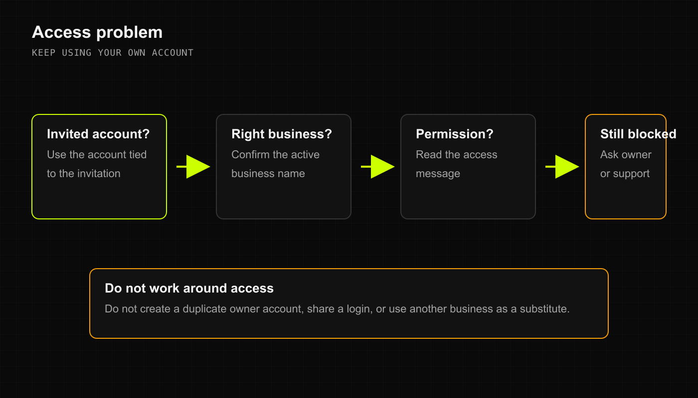

## You cannot sign in

1. Use the account attached to your access invitation. When the field says **Username or email**, enter the username or email already on that account.
2. Check spelling and complete the sign-in checks shown. Use the recovery option on that screen if you need to recover the account.
3. If recovery is unavailable or access is still blocked, contact private support. Never send a password or verification code.

Creating another owner account will not repair the original membership.

## The business you need is missing

Confirm that you accepted the correct business invitation. Ask the owner to review your membership in **Settings** through **Manage Team**. Do not select another business as a substitute.

## A page or action is blocked

1. Stop before submitting the action again.
2. Confirm the active business and read the access message.
3. Ask an authorized owner or manager to check the task's required permission in **Manage Team**.
4. After a confirmed change, reopen the page with your own account. If access is still wrong, report it privately.

A role name alone does not prove access to every action. Owning a business does not grant access to DRX platform administration.

## The wrong business appears

Do not record another sale, payment, or stock change. Leave unsaved work safely, switch to the intended business, and confirm its name before continuing. If a change may already have saved in the wrong business, have an authorized manager review it. Do not recreate it elsewhere as a correction.

Business device, location, and privacy badges are not reliable account-security evidence in the beta. Use Settings and verified membership records for those checks.

## Related articles

- [Help and support](../feature_overview/help-and-support.md)
