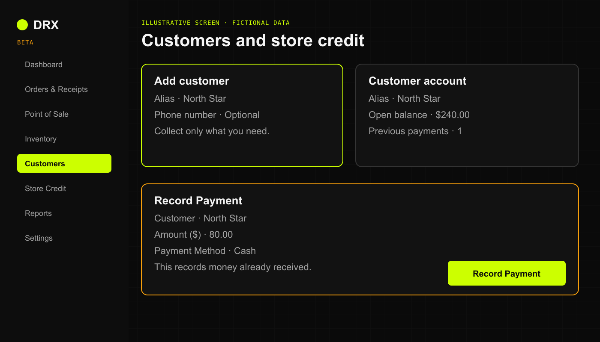
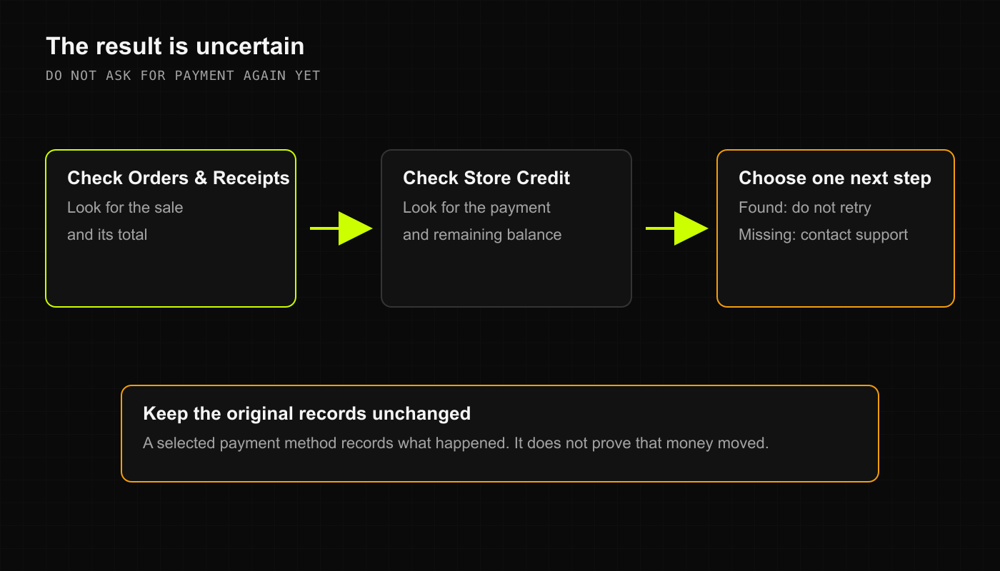

Illustrative screen with fictional data.

## A customer will not save or appear

1. Confirm the active business and search the agreed alias or another permitted identifier.
2. Check spelling and search for an existing profile before creating another.
3. Read the validation message. Enter only information allowed by the business's privacy settings.
4. If saving appeared to fail, check the customer list before retrying.

Checkout **Quick Create** requires a phone number in the current web beta. If the business uses alias-only records, do not collect a number or invent one to work around this. Ask the owner to review the profile through **Customers**.

A missing profile may require a retention review. Do not assume it can be restored after permanent deletion.

## Customer history is missing

Open the saved sale in **Orders & Receipts** and check its customer. A sale without that customer attached may not appear in their history. The recent orders list is limited to 50 entries.

An authorized user can review **Assign Customer** or **Change Customer** in **Sale Details**. Credit-sale reassignment needs manager or owner review. Do not recreate a completed sale to attach a profile or move balances between duplicate profiles yourself.

## Credit is unavailable

Confirm the attached customer, business, and permission. Read the available credit amount and the current total. If **CREDIT** is missing or blocked, ask an authorized manager to check eligibility and limits. Do not split a transaction or change the limit to bypass the restriction.

## A payment or balance looks wrong

1. Check whether the payment was received outside DRX.
2. Check the saved payment and customer before recording it again.
3. Compare credit sales, repayments, and approved corrections. Available credit and the amount owed are different figures.
4. Have an authorized manager reconcile the difference. Stop if the first submission's result is uncertain.

Do not create a new sale to record repayment. Do not change a balance just to dismiss an overdue warning.

## Related articles

- [Help and support](https://drx.featurebase.app/en/help/articles/2070517)
