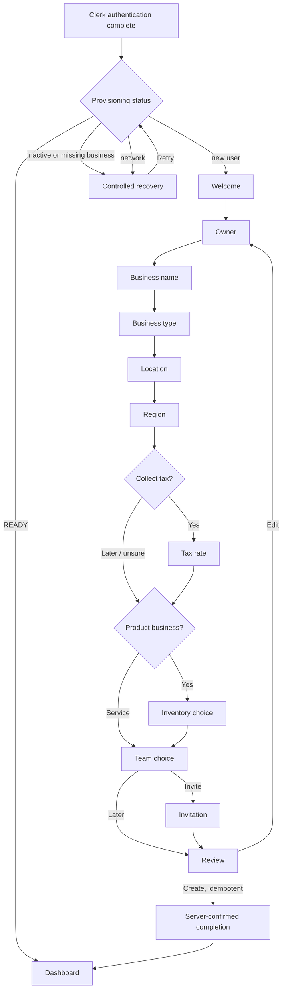

# DRX progressive onboarding

## Existing experience audit

The iOS app previously presented owner, business type, currency, time zone, and tax controls in one dense `Form`, with no orientation, location, inventory, team, review, or completion choice. The web app similarly requested business, role, team size, dashboard preset, and free-form tooling in one form. Neither surface had visible progress, draft resume, conditional sequencing, review editing, or field-level plain-language errors. Web and iOS asked different questions. Native picker-heavy controls and web focus/progress gaps also reduced accessibility. Provisioning was already gated and the Convex mutation already protected identity, tenant ownership, and retry idempotency; that logic remains authoritative.

## Final content map

| Step | Question and supporting copy | Fields/defaults | Validation and branch | Actions | Saved data / analytics |
|---|---|---|---|---|---|
| Welcome | Welcome to DRX; set up only the essentials. | None | Always shown for a new draft | Set Up My Business / Sign Out where session chrome provides it | Step; `onboarding_started` |
| Owner | What should your team call you? Used in history and transactions. | Full name; Clerk value can be supplied | Trimmed, required; role is always Owner | Continue / Back | Owner name; step viewed/completed/validation failed |
| Business name | What should we call your business? Editable later. | Business name | Trimmed and required | Continue / Back | Name |
| Business type | What kind of business are you setting up? | Six selectable cards | Required; service skips inventory | Continue / Back | Type |
| Location | Where does your business operate? Address remains internal. | Main Location, city, region, locale country | Location name has a useful default; street is nonessential | Continue / Back | Location summary |
| Region | Do these settings look right? | USD/device currency, device time zone | Confirm or edit | Continue / Back | Currency/time zone |
| Tax decision | Will you collect sales tax? User confirms legal applicability. | Yes, later, unsure | Yes reveals rate; other choices disable tax | Continue / Back | Tax decision |
| Tax rate | What default rate should DRX use? Overrides can come later. | Human percentage | Numeric 0–100; converted to basis points | Continue / Back | Rate basis points at submission |
| Inventory | Track inventory quantities? Explains stock history. | Yes/not yet | Only product businesses | Continue / Back | Tracking choice |
| Team | Will anyone else use DRX? | Invite/later | Optional; invite reveals one invitation | Continue / Back | Invite choice |
| Invitation | Who would you like to invite? | Email, simple role; Manager default | Valid email | Continue / Back | Invitation fields |
| Review | Review your setup; all settings remain editable. | Concise cards | Edit returns directly to review data without loss | Create My Workspace / Back | Final draft; submission started |
| Completion | Workspace ready and server-confirmed. | Created summary retained during transition | Only after typed success or already-onboarded response | Add product recommended; dashboard routing | Draft cleared; completed/first action |

Analytics must contain only step, platform, branching choices, duration, and error category—never contact details, addresses, Clerk IDs, or database IDs.

## Route and recovery diagram

## State and persistence model

Both clients use the same named typed states for draft navigation: `welcome`, `ownerProfile`, `businessName`, `businessType`, `location`, `regionalSettings`, `taxDecision`, `taxDetails`, `inventoryDecision`, `teamDecision`, `teamInvitation`, `review`, `submitting`, and `completed`. A transition function owns forward/back branching rather than unrelated booleans. Review edits change only the chosen state. The version-1 draft saves every valid transition to UserDefaults on iOS and localStorage on web, never stores tokens, ignores unknown versions, survives refresh/relaunch, and clears only after confirmed completion. Provisioning recovery (`recoverableError`) is handled separately as an `AppEnvironment.rootState` outcome produced by `checkProvisioning`, not as part of the draft-navigation state machine.

## Before and after

| Improvement | Before | Now | Benefit / tests |
|---|---|---|---|
| Density | One long configuration form | One conversational decision at a time | Lower cognitive load; navigation tests |
| Disclosure | Tax and advanced preferences always visible | Tax rate, inventory, and invite appear only when relevant | Fewer irrelevant decisions; branch tests |
| Momentum | No progress or save feedback | Accessible progress and saved status | Confidence and resumability; persistence tests |
| Validation | Browser/final-submit failures | Inline plain-language errors preserving input | Faster correction; validation tests |
| Parity | Different native and desktop questions | Shared state names, order, defaults, and copy | Predictable cross-device setup |
| Completion safety | Direct form completion | Disabled duplicate submit and existing idempotent server mutation | Retry without duplicate tenant records; provisioning tests |
| Accessibility | Dense controls and weak focus context | Large cards, labels, progress semantics, focus movement, Reduce Motion handling | Keyboard, VoiceOver, and Dynamic Type support |
